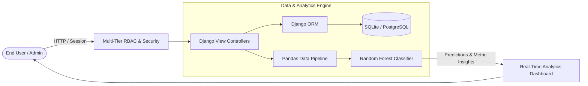

# Unified Digital Currency Management & Analytics Platform


An enterprise-grade, full-stack financial analytics web application engineered with **Django** and **Scikit-Learn**, designed to analyze multi-relational transaction metrics and predict digital currency usage behavior.

---

## System Architecture



---

## Key Features & Highlights

* **Multi-Tier Role-Based Access Control (RBAC):** Admin privilege separation to review, activate, or audit registered users prior to granting analytical dashboard access.
* **Predictive Machine Learning Pipeline:** Integrated **Scikit-Learn Random Forest Classifier** trained on multi-relational datasets combining demographics, transaction volume, and wallet counts.
* **Feature Engineering via Pandas:** Cleanses, standardizes, and merges multi-source transaction logs into structured DataFrames for model training and real-time inference.
* **Dynamic Analytics Dashboard:** Interactive web interface providing real-time model evaluation metrics (Accuracy, Precision, Recall, F1-Score) and on-demand predictive classification.

---

## Technology Stack

* **Backend Framework:** Python, Django
* **Machine Learning:** Scikit-Learn (Random Forest), Pandas, NumPy, Joblib
* **Database:** SQLite / PostgreSQL
* **Frontend:** HTML5, CSS3, Bootstrap 5

---

## Repository Structure

```text
digital-currency-analytics-platform/
├── admins/                # Admin auditing & user verification logic
├── users/                 # User authentication & profile management
├── digitalcurrency/       # Core project settings & routing
├── templates/             # Bootstrap 5 HTML templates
├── manage.py
├── requirements.txt
├── .gitignore
├── LICENSE
└── README.md
```

---

## Local Setup & Execution

### 1. Set Up Environment
```bash
git clone https://github.com/mullewarpramodh-tech/digital-currency-analytics-platform.git
cd digital-currency-analytics-platform

python -m venv venv
source venv/bin/activate  # On Windows: venv\Scripts\activate
pip install -r requirements.txt
```

### 2. Run Database Migrations
```bash
python manage.py makemigrations
python manage.py migrate
```

### 3. Start Development Server
```bash
python manage.py runserver
```
*Access the platform at `http://127.0.0.1:8000`.*

---

## License
This project is licensed under the MIT License - see the [LICENSE](LICENSE) file for details.
