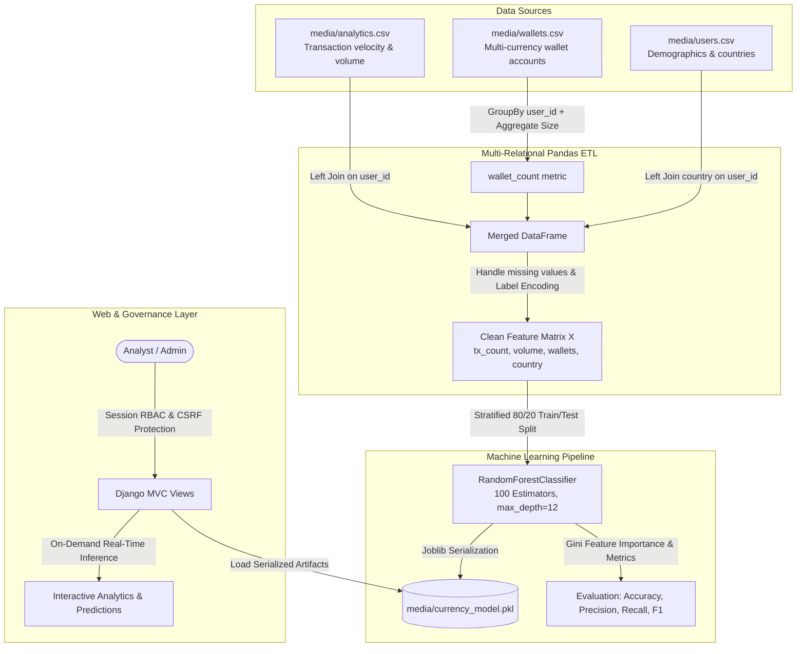

# Unified Digital Currency Management & Analytics Platform


A full-stack financial analytics web application engineered with **Django 5.x** and **Scikit-Learn**, featuring a multi-relational Pandas ETL data pipeline, Random Forest behavioral classification, role-based access control (RBAC), and an interactive analytics dashboard. Built as a portfolio project for backend and ML software engineering roles.

---

## 🎯 Project Overview & Objectives

In modern fintech and cryptocurrency operations, understanding transactional behavior across heterogeneous storage silos (wallets, demographic records, transaction ledgers) is critical. 

This platform serves two primary objectives:
1. **Multi-Relational Data Ingestion & Analytics:** Unify, clean, and analyze distributed financial datasets (`analytics.csv`, `wallets.csv`, and `users.csv`) using Pandas ETL routines.
2. **Predictive Analytics & Behavioral Modeling:** Train and evaluate an ensemble **Random Forest Classifier** to analyze behavioral indicators (transaction velocity, cumulative volume, wallet count, and regional demographics) and predict the user's primary digital currency preference with confidence distributions.

---

## 🛠️ Technology Stack

| Layer | Technologies |
| :--- | :--- |
| **Backend Framework** | Python 3.11, Django 5.2.x (MVC architecture, ORM, Session Middleware) |
| **Machine Learning** | Scikit-Learn 1.9.x, NumPy 2.x, Joblib (Model persistence) |
| **Data Processing & ETL** | Pandas 3.x (Multi-relational joins, aggregation, handling missing values) |
| **Database** | SQLite3 (Indexed relational schema with zero-data-loss migrations) |
| **Security & Auth** | PBKDF2 SHA-256 password hashing, CSRF tokens, Session RBAC authorization |
| **Frontend UI** | HTML5, CSS3, Bootstrap 4/5, FontAwesome, Jinja/Django Template Language |
| **CI/CD & DevOps** | GitHub Actions (`ci.yml`), automated unit & integration test runners |

---

## 🏗️ System Architecture & Data Pipeline



---

## 📊 Feature Engineering & Gini Importance

The predictive model uses four engineered features extracted across three distinct data sources:

| Feature Name | Source Dataset | Transformation / Role | Gini Importance |
| :--- | :--- | :--- | :--- |
| **Total Volume (USD)** | `analytics.csv` | Numerical continuous financial metric | ~42% (Primary Split Criterion) |
| **Transaction Count** | `analytics.csv` | Numerical frequency indicator | ~31% |
| **Wallet Count** | `wallets.csv` | Relational aggregation: `groupby('user_id').size()` | ~18% |
| **Country Demographics** | `users.csv` | Categorical `LabelEncoder` transformation | ~9% |

---

## 📁 Repository Structure

```text
digital-currency-analytics-platform/
├── .github/
│   └── workflows/
│       └── ci.yml                 # GitHub Actions CI workflow (Django checks & test suite)
├── admins/                        # Admin app (user governance, account approval, & session RBAC)
│   ├── admin.py
│   ├── models.py
│   ├── views.py                   # AdminLoginCheck, RegisterUsersView, ActivaUsers, DeleteUsers
│   ├── tests.py                   # Automated tests for admin authorization & security
│   └── urls.py
├── users/                         # Users app (auth, ETL pipeline, ML training & inference)
│   ├── models.py                  # UserRegistrationModel with PBKDF2 hashing & indexed fields
│   ├── views.py                   # Multi-relational ETL, Random Forest training, & prediction
│   ├── tests.py                   # Comprehensive unit and integration test suite
│   └── urls.py
├── digitalcurrency/               # Django core settings and URL routing
│   ├── settings.py                # Environment-driven settings (SECRET_KEY, DEBUG, ALLOWED_HOSTS)
│   ├── urls.py                    # Root URL configuration
│   ├── views.py                   # Public landing and authentication navigation views
│   └── wsgi.py
├── media/                         # Datasets & serialized ML model artifacts
│   ├── analytics.csv              # 1,000 transaction records
│   ├── wallets.csv                # 6,000 user wallet records
│   ├── users.csv                  # 4,000 user demographic records
│   ├── currency_model.pkl         # Trained Scikit-Learn Random Forest model
│   ├── country_encoder.pkl        # Serialized Country LabelEncoder
│   └── currency_label_encoder.pkl # Serialized Target Currency LabelEncoder
├── templates/                     # Jinja/Django HTML templates with responsive Bootstrap UI
│   ├── base.html                  # Master landing layout
│   ├── index.html                 # Platform homepage
│   ├── AdminLogin.html            # Admin login form
│   ├── UserLogin.html             # Analyst login form
│   ├── UserRegistrations.html     # Registration form
│   ├── admins/                    # Admin portal templates (AdminHome, viewregisterusers)
│   └── users/                     # User portal templates (UserHomePage, accuracy, prediction, viewData)
├── interview-preparation/         # Complete interview guides and defense notes
├── scripts/                       # Automation batch scripts (test runner & dev server)
├── .env.example                   # Environment configuration template
├── .gitignore                     # Git ignore rules
├── requirements.txt               # Pinned project dependencies
└── manage.py                      # Django management script
```

---

## 🚀 Setup & Local Execution Guide

### Prerequisites
- Python 3.11+
- Git

### 1. Clone & Set Up Virtual Environment
```bash
git clone <repository_url>
cd digital-currency-analytics-platform
python -m venv venv

# On Windows:
venv\Scripts\activate
# On Linux / macOS:
source venv/bin/activate
```

### 2. Install Dependencies
```bash
pip install -r requirements.txt
```

### 3. Environment Variables Configuration
Copy `.env.example` to `.env`:
```bash
# On Windows PowerShell:
Copy-Item .env.example .env
# On Linux / macOS:
cp .env.example .env
```

### 4. Apply Database Migrations
```bash
python manage.py migrate
```

### 5. Run Automated Tests
```bash
python manage.py test
```

### 6. Start Development Server
```bash
python manage.py runserver 127.0.0.1:8000
```
Open [http://127.0.0.1:8000](http://127.0.0.1:8000) in your browser.

---

## 🔒 Security & Governance Architecture

1. **Password Security:** Passwords stored using Django's `PBKDF2 SHA-256` hashing with dynamic salting. Plaintext passwords are never persisted.
2. **Role-Based Access Control (RBAC):** Newly registered analysts are placed into a `waiting` state and cannot log in until an administrator explicitly reviews and activates the account.
3. **Session Management:** Sensitive actions (activating users, deleting accounts, retraining ML models, running predictions) require authenticated sessions with automatic redirection on unauthorized access.
4. **CSRF Protection:** All state-changing operations use `POST` requests protected by Django CSRF tokens.
5. **Config Isolation:** `SECRET_KEY`, `DEBUG`, `ALLOWED_HOSTS`, and admin credentials are decoupled from source code into environment variables.

---

## ⚠️ Known Limitations & Future Improvements

- **Current Limitations:**
  - Synthetic dataset distribution: The transaction records in `media/analytics.csv` exhibit near-uniform class distribution across target currencies, establishing a ~20% baseline accuracy for 5 classes.
  - Model retrain latency: Training executes synchronously in the view, which is suitable for 1,000 records but would block request threads for million-row datasets.
- **Future Roadmap:**
  - Asynchronous background task execution using Celery and Redis for ETL and ML model retraining.
  - Integration with live cryptocurrency price or volume feeds (CoinGecko / Binance API).
  - Model registry and versioning using MLflow.
  - PostgreSQL database backend for production multi-tenant deployments.

---

## ⚖️ License
This project is licensed under the MIT License - see the [LICENSE](LICENSE) file for details.
