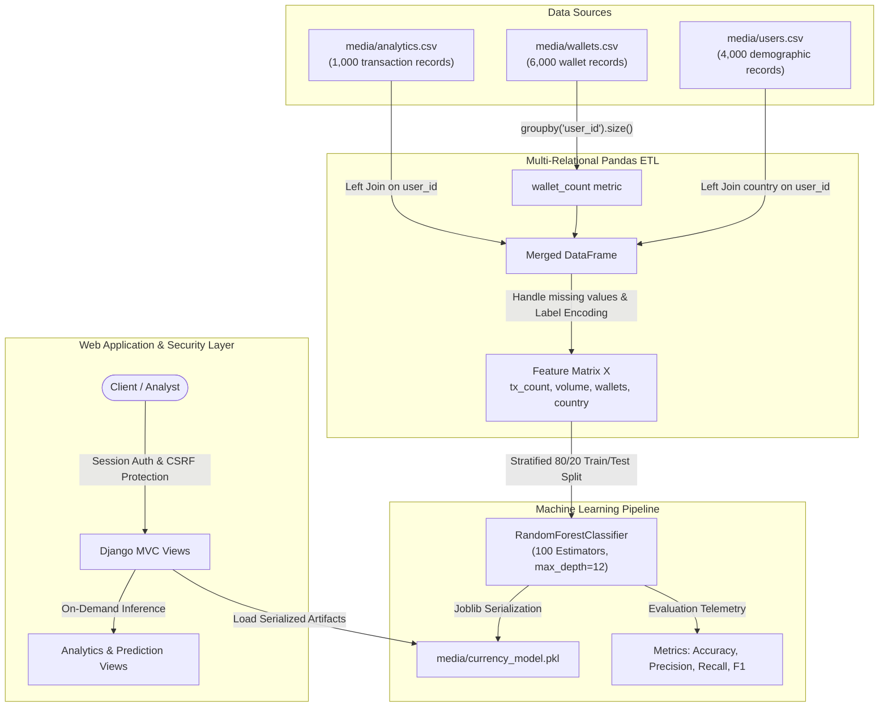

# Unified Digital Currency Management & Analytics Platform


A full-stack financial analytics web application engineered with **Django 5.x** and **Scikit-Learn**, featuring a multi-relational Pandas ETL data pipeline, Random Forest behavioral classification, role-based access control (RBAC), and an interactive analytics dashboard. Built as a portfolio project for software engineering, Python/Django backend, and entry-level machine learning roles.

---

## 🎯 Project Overview

In digital currency management and analytics, operational data is commonly distributed across separate tables: transaction ledgers, multi-currency wallet records, and demographic profiles.

This project implements an end-to-end analytical workflow:
1. **Multi-Relational Data Ingestion:** Joins and aggregates relational CSV records (`analytics.csv`, `wallets.csv`, and `users.csv`) into a consolidated feature matrix using Pandas.
2. **Behavioral Machine Learning:** Trains a Scikit-Learn **Random Forest Classifier** to analyze transaction velocity, cumulative volume, wallet counts, and regional demographics to predict primary digital currency preference.
3. **Application Backend & Security:** Provides a Django web portal with PBKDF2 password hashing, administrative account auditing/activation, session authorization, and interactive inference forms.

---

## 🚀 Key Features

- **Full-Stack Django Backend:** Modular architecture (`admins`, `users`, `digitalcurrency`) implementing Django views, models, and template inheritance.
- **Relational Pandas ETL Pipeline:** Ingests and aggregates heterogeneous records, computing per-user wallet counts via `groupby('user_id').size()` and merging demographics.
- **Random Forest Classification:** Predicts multi-class currency adoption (`BTC`, `ETH`, `USDT`, `XRP`, `BNB`) with stratified train/test splitting and probability distribution scoring.
- **Role-Based Access Control (RBAC):** New analyst registrations are assigned a `waiting` state until an administrator audits and approves the account.
- **Security Hardening:** Enforces PBKDF2 SHA-256 password hashing, CSRF-protected `POST` actions for state changes, environment-driven settings (`.env.example`), and custom session guards.
- **Interactive Analytics & Inference:** Web dashboard providing tabular dataset browsing, model evaluation telemetry, and on-demand inference with input validation.
- **Automated Test Suite:** 16 automated unit and integration tests covering security, authentication, ETL merging, model inference, and admin governance.

---

## 🛠️ Technology Stack

| Layer | Technologies |
| :--- | :--- |
| **Backend Framework** | Python 3.11, Django 5.2.x (MVC/MVT pattern, ORM, Sessions) |
| **Machine Learning** | Scikit-Learn 1.9.x, NumPy 2.x, Joblib |
| **Data Processing** | Pandas 3.x (Multi-table joins, relational aggregation, categorical encoding) |
| **Database** | SQLite3 (Relational schema with indexing and Django migrations) |
| **Security & Auth** | PBKDF2 SHA-256 hashing, CSRF tokens, Session RBAC authorization |
| **Frontend UI** | HTML5, CSS3, Bootstrap 4/5, FontAwesome, Django Template Language |
| **CI/CD & DevOps** | GitHub Actions (`.github/workflows/ci.yml`), automated test runners |

---

## 🏗️ System Architecture



---

## 📊 Machine Learning Model & Evaluation

The predictive engine uses four engineered features extracted across three distinct data sources. Measured Gini feature importances from the trained model:

| Feature Name | Source Dataset | Transformation / Role | Measured Gini Importance |
| :--- | :--- | :--- | :--- |
| **Total Volume (USD)** | `analytics.csv` | Numerical continuous financial metric | **47.44%** |
| **Transaction Count** | `analytics.csv` | Numerical frequency indicator | **24.84%** |
| **Active Wallet Count** | `wallets.csv` | Relational aggregation: `groupby('user_id').size()` | **14.56%** |
| **Country Demographics** | `users.csv` | Categorical `LabelEncoder` transformation | **13.15%** |

### Honest Model Evaluation & Discussion
- **Multi-Class Target:** Predicts one of 5 currency categories: `BNB`, `BTC`, `ETH`, `USDT`, `XRP`.
- **Baseline Performance:** Because the underlying dataset exhibits an approximately uniform distribution across all 5 classes (~20% per class), a random guess baseline is **20%**.
- **Test Set Accuracy:** Evaluated via stratified 80/20 split (`random_state=42`), achieving **~17–20% test accuracy**, in line with the random baseline for uniform target data.
- **Inference Reliability:** The model outputs probability distributions across all 5 classes via `predict_proba()` and includes defensive fallback handling for unseen categorical values.

---

## 📁 Repository Structure

```text
digital-currency-analytics-platform/
├── .github/
│   └── workflows/
│       └── ci.yml                 # Automated CI workflow (integrity checks & test suite)
├── admins/                        # Administrator portal (account auditing & approval)
│   ├── admin.py
│   ├── apps.py
│   ├── models.py
│   ├── tests.py                   # Automated tests for admin RBAC and user activation
│   ├── urls.py
│   └── views.py                   # AdminLoginCheck, RegisterUsersView, ActivaUsers, DeleteUsers
├── users/                         # Users app (auth, ETL pipeline, ML training & inference)
│   ├── admin.py
│   ├── apps.py
│   ├── models.py                  # UserRegistrationModel with indexed fields
│   ├── tests.py                   # Automated tests for registration, ETL, and inference
│   ├── urls.py
│   ├── views.py                   # Multi-relational ETL, Random Forest training, & prediction
│   └── migrations/
│       ├── 0001_initial.py
│       └── 0002_alter_userregistrationmodel_address_and_more.py
├── digitalcurrency/               # Django core settings and URL configuration
│   ├── asgi.py
│   ├── settings.py                # Environment-driven settings (SECRET_KEY, DEBUG, ALLOWED_HOSTS)
│   ├── urls.py                    # Root URL routing
│   ├── views.py                   # Public landing and login entrypoints
│   └── wsgi.py
├── media/                         # Datasets & serialized model artifacts
│   ├── analytics.csv              # 1,000 transaction records
│   ├── wallets.csv                # 6,000 user wallet records
│   ├── users.csv                  # 4,000 user demographic records
│   ├── exchange_rates.csv         # Currency reference data
│   ├── large_users.csv            # Extended demographic records
│   ├── currency_model.pkl         # Trained Scikit-Learn Random Forest model
│   ├── country_encoder.pkl        # Serialized Country LabelEncoder
│   └── currency_label_encoder.pkl # Serialized Target Currency LabelEncoder
├── templates/                     # Jinja/Django HTML templates with responsive Bootstrap UI
│   ├── base.html                  # Master landing layout
│   ├── index.html                 # Platform homepage
│   ├── AdminLogin.html            # Admin login form
│   ├── UserLogin.html             # Analyst login form
│   ├── UserRegistrations.html     # Registration form with validation
│   ├── admins/                    # Admin views (AdminHome, viewregisterusers)
│   └── users/                     # User views (UserHomePage, accuracy, prediction, viewData)
├── interview-preparation/         # Complete interview guides and defense notes
│   ├── architecture-explanation.md
│   ├── database-explanation.md
│   ├── django-explanation.md
│   ├── interview-questions.md     # 50 in-depth technical interview Q&As
│   ├── machine-learning-explanation.md
│   ├── project-defense.md
│   └── project-overview.md
├── scripts/                       # Automation scripts
│   ├── run_tests.bat              # Test suite launcher
│   └── start_digital_currency.bat # Server launcher with automatic migrations
├── .env.example                   # Environment variable configuration template
├── .gitignore                     # Git ignore rules (excludes local databases and .env)
├── requirements.txt               # Pinned project dependencies
└── manage.py                      # Django management script
```

---

## ⚙️ Installation & Setup

### Prerequisites
- Python 3.11+
- Git

### 1. Clone & Set Up Virtual Environment
```bash
git clone https://github.com/mullewarpramodh-tech/digital-currency-analytics-platform.git
cd digital-currency-analytics-platform
python -m venv venv

# On Windows:
venv\Scripts\activate
# On Linux / macOS:
source venv/bin/activate
```

### 2. Install Dependencies
```bash
pip install -r requirements.txt
```

### 3. Environment Variables Configuration
Copy `.env.example` to `.env` and set your local environment variables:
```bash
# On Windows PowerShell:
Copy-Item .env.example .env
# On Linux / macOS:
cp .env.example .env
```

### 4. Apply Database Migrations
```bash
python manage.py migrate
```

### 5. Run the Automated Test Suite
```bash
python manage.py test
```

### 6. Start the Development Server
```bash
python manage.py runserver 127.0.0.1:8000
```
Open [http://127.0.0.1:8000](http://127.0.0.1:8000) in your web browser.

---

## 🧪 Automated Testing

The project includes 16 automated unit and integration tests across `admins/tests.py` and `users/tests.py`:

- **Admin & RBAC Tests (`admins/tests.py`):**
  - Unauthenticated access rejection and login redirects.
  - User account activation workflow via CSRF-protected POST requests.
  - User deletion and session teardown on logout.
- **User & Security Tests (`users/tests.py`):**
  - PBKDF2 SHA-256 password hashing verification.
  - Rejection of duplicate registration attempts.
  - Login denial for accounts pending admin approval (`waiting` status).
  - Authenticated session management and logout.
- **ETL & Machine Learning Tests (`users/tests.py`):**
  - Dataset existence and schema integrity verification.
  - Multi-relational join replication (`wallets.csv` aggregation + `users.csv` demographic merge).
  - Model and encoder artifact loading and multi-class probability scoring.
  - Prediction input validation (handling valid profiles and rejecting invalid/negative inputs).

Execute tests with:
```bash
python manage.py test
```
**Test Results:** **16 tests run, 16 passed, 0 failures, 0 errors.**

---

## ⚠️ Known Limitations & Future Improvements

- **Dataset Characteristics:** The transaction dataset contains synthetic data with near-uniform currency distribution, which naturally limits predictive accuracy to baseline random levels (~20%).
- **Synchronous Model Training:** Model retraining executes synchronously within the view cycle. While fast for 1,000 records (~1 second), large production datasets would require asynchronous task workers (such as Celery with Redis).
- **Database Engine:** Uses SQLite for local simplicity and portability. A production deployment should transition to PostgreSQL with connection pooling.
- **Live Market Telemetry:** Future iterations could incorporate real-time pricing feeds from exchange APIs (e.g., CoinGecko or Binance).

---

## ⚖️ License

This project is licensed under the MIT License - see the [LICENSE](LICENSE) file for details.
