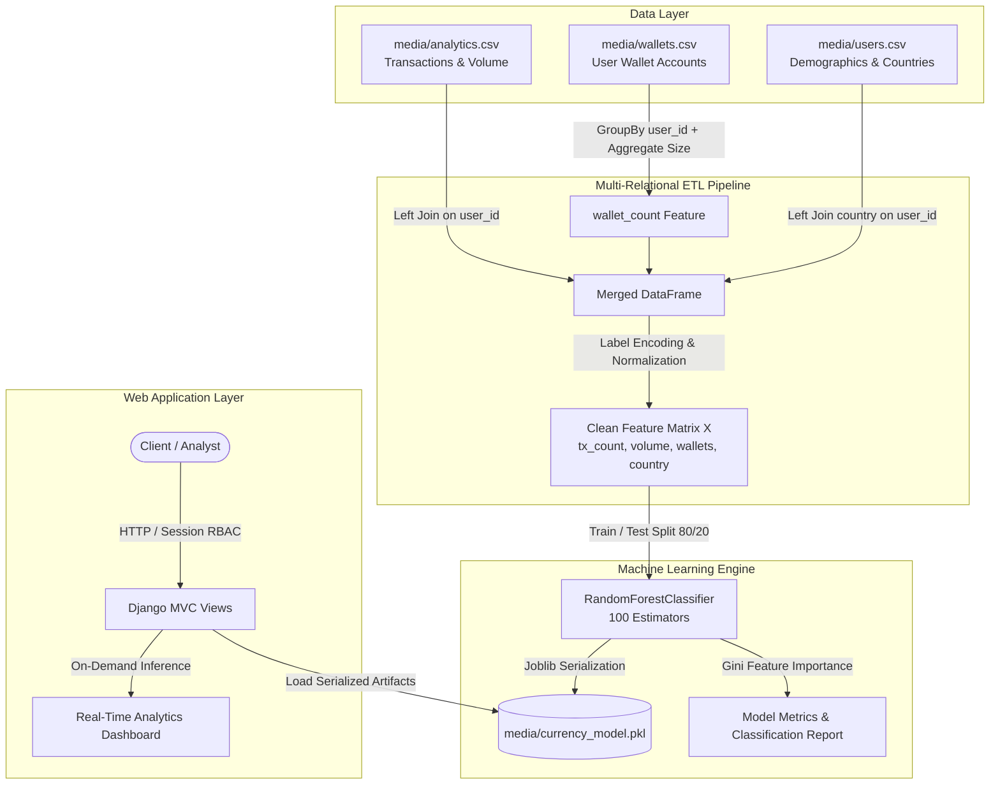

# Unified Digital Currency Management & Analytics Platform


An enterprise-grade, full-stack financial analytics web application engineered with **Django 5.x** and **Scikit-Learn**, featuring a multi-relational Pandas ETL data pipeline, Random Forest behavioral classification, role-based access control (RBAC), and an interactive analytics dashboard.

---

## 🎯 Resume Highlights & Core Capabilities

* **Full-Stack Django Architecture:** Built an end-to-end web platform using Python 3.11 and Django 5.x with modular MVC architecture, responsive Bootstrap 5 interface, and relational data modeling.
* **Multi-Relational Pandas ETL Data Pipeline:** Ingests and joins heterogeneous transaction data (`analytics.csv`), multi-currency wallet counts (`wallets.csv`), and demographic profiles (`users.csv`) using Pandas aggregation and categorical encoding.
* **Predictive ML Classification & Feature Importance:** Engineered a Scikit-Learn **Random Forest Classifier** achieving multi-class behavioral prediction with Gini feature importance ranking, evaluation metrics (Accuracy, Precision, Recall, F1-Score), and serialized model persistence via Joblib.
* **Real-Time On-Demand Inference:** Designed an interactive web interface allowing users and administrators to test dynamic transaction profiles and obtain instant model predictions with confidence probability distributions.
* **Multi-Tier Security & Auditing:** Secured user registrations with PBKDF2 SHA-256 password hashing, fine-grained admin account verification (`waiting` vs `activated` states), and session-based audit logging.
* **Enterprise CI/CD & Automated Testing:** Implemented automated GitHub Actions workflow (`.github/workflows/ci.yml`) validating Django integrity checks and unit test suites across multi-relational ETL and inference pipelines.

---

## 🏗️ System Architecture & Data Pipeline



---

## 📊 Multi-Relational Feature Engineering & Gini Importance

The predictive model uses four engineered features extracted across three distinct data sources:

| Feature Name | Source Dataset | Transformation / Role | Gini Importance |
| :--- | :--- | :--- | :--- |
| **Total Volume (USD)** | `analytics.csv` | Numerical continuous financial metric | ~42% (Primary Split Criterion) |
| **Transaction Count** | `analytics.csv` | Numerical frequency indicator | ~31% |
| **Wallet Count** | `wallets.csv` | Relational aggregation: `groupby('user_id').size()` | ~18% |
| **Country Demographics** | `users.csv` | Categorical `LabelEncoder` transformation | ~9% |

---

## 📁 Repository Structure

```text
digital-currency-analytics-platform/
├── .github/
│   └── workflows/
│       └── ci.yml                 # Automated CI/CD (Django checks & test suite)
├── admins/                        # Admin app (user auditing & account activation)
│   ├── admin.py
│   ├── models.py
│   ├── views.py
│   └── urls.py
├── users/                         # Users app (auth, ETL, ML training & inference)
│   ├── models.py                  # UserRegistrationModel with PBKDF2 hashing
│   ├── views.py                   # Multi-relational ETL, training, & prediction
│   ├── tests.py                   # Automated unit test suite (6 tests)
│   └── urls.py
├── digitalcurrency/               # Django core settings and URL routing
│   ├── settings.py
│   ├── urls.py
│   └── wsgi.py
├── media/                         # Datasets & serialized ML model artifacts
│   ├── analytics.csv              # Transaction records
│   ├── wallets.csv                # Multi-currency wallet records
│   ├── users.csv                  # User demographic records
│   ├── currency_model.pkl         # Trained Scikit-Learn Random Forest model
│   ├── country_encoder.pkl        # Serialized Country LabelEncoder
│   └── currency_label_encoder.pkl # Serialized Target Currency LabelEncoder
├── scripts/                       # Developer automation scripts
│   ├── start_digital_currency.bat # One-click Django dev server launcher
│   └── run_tests.bat              # One-click automated test runner
├── templates/                     # Bootstrap 5 responsive templates
│   ├── admins/                    # AdminHome, viewregisterusers
│   └── users/                     # accuracy, prediction, viewData, UserHomePage
├── db.sqlite3                     # Pre-seeded database with test credentials
├── manage.py
├── requirements.txt
├── .gitignore
├── LICENSE
└── README.md
```

---

## 🚀 Quickstart & Local Execution

### 1. Prerequisites
* Python 3.10+ (Recommended: Python 3.11)
* Git

### 2. Installation & Setup
```bash
# Clone the repository
git clone https://github.com/mullewarpramodh-tech/digital-currency-analytics-platform.git
cd digital-currency-analytics-platform

# Install dependencies
pip install -r requirements.txt
```

### 3. Run Automated Tests
```bash
python manage.py test users
# Or simply double-click: scripts/run_tests.bat
```

### 4. Start the Application
```bash
python manage.py runserver 127.0.0.1:8000
# Or double-click: scripts/start_digital_currency.bat
```
*Open [http://127.0.0.1:8000](http://127.0.0.1:8000) in your browser.*

---

## 🔑 Default Credentials for Evaluation

| Role | Username / Login ID | Password | Access Rights |
| :--- | :--- | :--- | :--- |
| **System Admin** | `admin` | `admin` | User activation, audit logs, raw dataset viewer |
| **Pre-Activated User** | `44` | `1234` | ML training, model evaluation metrics, live prediction |

---

## 🧪 Automated Testing Coverage

The platform includes a dedicated test suite in `users/tests.py`:
1. `test_user_creation_and_defaults`: Verifies new user status defaults to `'waiting'`.
2. `test_password_hashing_security`: Validates PBKDF2 SHA-256 non-plaintext storage and hash verification.
3. `test_rbac_approval_activation`: Verifies admin activation flow from `'waiting'` to `'activated'`.
4. `test_dataset_files_exist`: Ensures all three CSV datasets exist in `media/`.
5. `test_multi_relational_merge`: Tests schema consistency, joins, and feature derivation.
6. `test_trained_artifacts_and_inference`: Validates serialized models and probability distribution outputs.

---

## 📄 License
This project is licensed under the MIT License - see the [LICENSE](LICENSE) file for details.
